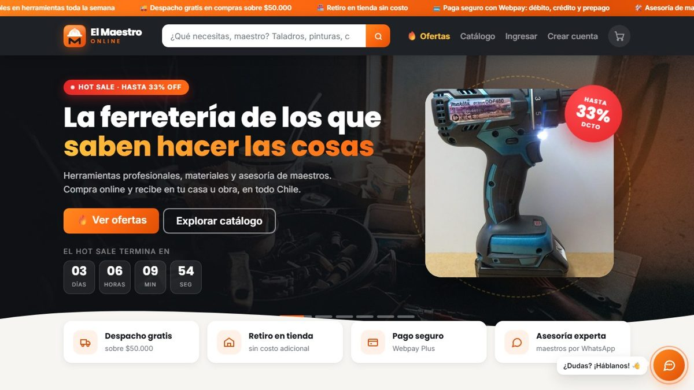
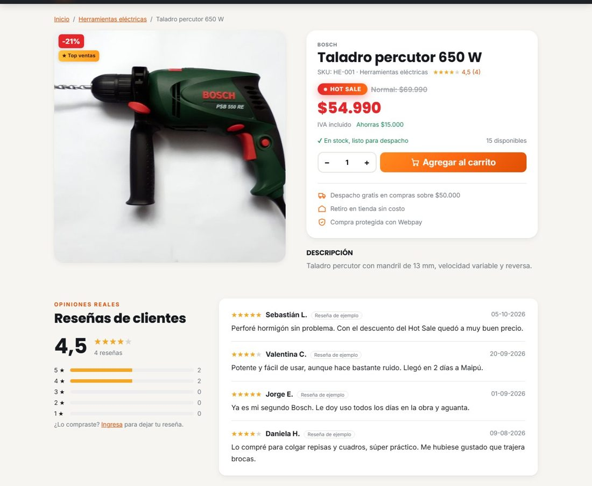
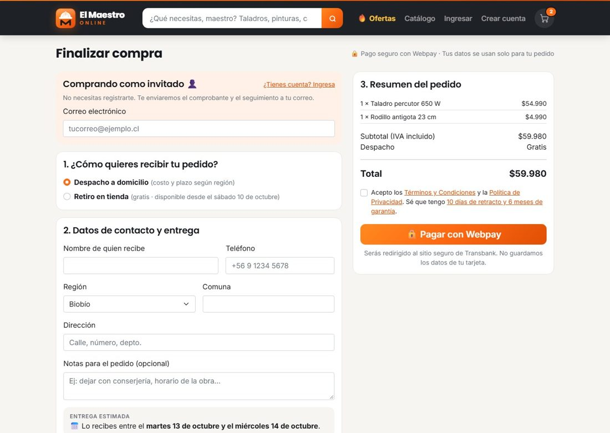
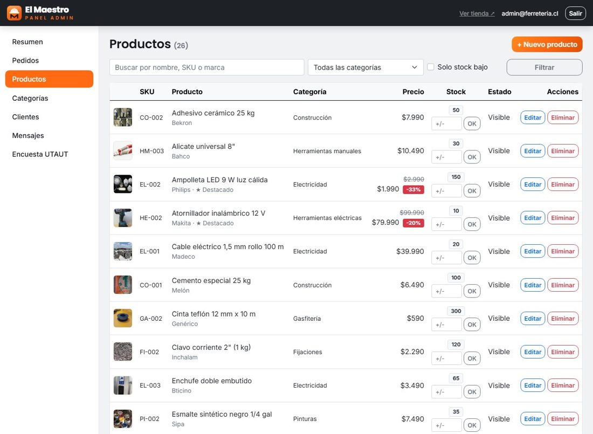
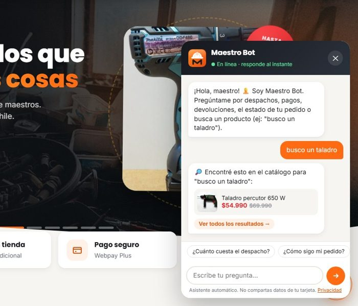

# El Maestro Online · E-commerce de ferretería

Tienda online de una ferretería chilena **simulada**, desarrollada como proyecto académico para la asignatura *Adopción de Tecnologías* (TIEL25) de INACAP. Tiene catálogo con ofertas, carrito, compra con o sin cuenta, pago con **Webpay Plus** de Transbank, chatbot, recomendaciones personalizadas, logística por región y panel de administración.



**Tecnologías:** ASP.NET Core 8 MVC · Entity Framework Core 8 · SQL Server · ASP.NET Core Identity · Bootstrap 5 · Webpay Plus (API REST) · Docker

> ⚠️ Proyecto académico: la tienda, sus datos de contacto y las reseñas de demostración son ficticios. Los pagos usan el ambiente de pruebas de Transbank o un simulador, nunca dinero real.

---

## Índice

1. [Funcionalidades](#1-funcionalidades)
2. [Inicio rápido con Docker (Windows, Mac o Linux)](#2-inicio-rápido-con-docker-windows-mac-o-linux)
3. [Inicio con .NET instalado en el equipo](#3-inicio-con-net-instalado-en-el-equipo)
4. [Configuración y secretos](#4-configuración-y-secretos)
5. [Probar el pago](#5-probar-el-pago)
6. [Cómo funciona por dentro](#6-cómo-funciona-por-dentro)
7. [Seguridad](#7-seguridad)
8. [Estructura del proyecto](#8-estructura-del-proyecto)
9. [Publicar en producción](#9-publicar-en-producción)
10. [Créditos](#10-créditos)

---

## 1. Funcionalidades

| Área | Qué incluye |
|---|---|
| **Página principal** | Slider *Hot Sale* con cuenta regresiva, categorías con foto, ofertas relámpago, "Recomendado para ti", destacados, novedades y animaciones al hacer scroll. |
| **Catálogo** | Búsqueda, filtros por categoría y "solo ofertas", orden por precio, nombre o descuento, ficha con zoom, stock real y reseñas. |
| **Carrito y pago** | Validación de stock, barra hacia el despacho gratis, complementos sugeridos, **compra como invitado** (sin registro) o con cuenta, y pago con Webpay. |
| **Logística** | Tarifas y plazos para las 16 regiones de Chile, despacho gratis sobre $50.000, retiro en tienda, fecha estimada en días hábiles, código de seguimiento y página pública "¿Dónde está mi pedido?". |
| **Cuentas** | Registro con consentimiento informado, inicio de sesión, perfil, historial de pedidos. |
| **Atención al cliente** | Chatbot *Maestro Bot* (preguntas frecuentes y búsqueda de productos), formulario de contacto, WhatsApp y correo en un botón flotante. |
| **Recomendaciones** | Según los productos vistos, las compras anteriores y lo que otros clientes compraron junto. Cada sugerencia explica su motivo. |
| **Panel admin** (`/Admin`) | Resumen de ventas, inventario (productos, ofertas, stock, imágenes), categorías, pedidos por estado con despacho y seguimiento, clientes, mensajes de contacto y resultados de la encuesta. |
| **Encuesta UTAUT** (`/Encuesta`) | Instrumento de aceptación tecnológica de 15 ítems. El admin ve promedios, gráficos, alfa de Cronbach y correlaciones, y puede **descargar las respuestas en Excel (CSV)**. |
| **Legal** | Términos y condiciones, política de privacidad y cookies, cambios y devoluciones, créditos de imágenes (Ley 19.496, Ley 19.628 / 21.719, Ley 17.336). |
| **SEO** | Títulos y descripciones por página, Open Graph, datos estructurados (schema.org), `robots.txt` y `sitemap.xml`. |
| **Móvil** | Diseño adaptable a cualquier pantalla. |

<p align="center">
  
  
</p>
<p align="center">
  
  
</p>

---

## 2. Inicio rápido con Docker (Windows, Mac o Linux)

Es la forma más simple: **no necesitas instalar .NET ni SQL Server**, solo [Docker Desktop](https://www.docker.com/products/docker-desktop/).

```bash
git clone https://github.com/gustavoespi27/Maestro-Online-Ecommerce.git
cd Maestro-Online-Ecommerce

# 1. Crea tu archivo de configuración y cambia las contraseñas
cp .env.example .env          # en Windows (PowerShell): copy .env.example .env

# 2. Levanta la base de datos y la tienda
docker compose up --build
```

Abre **http://localhost:8080**. La primera vez tarda un par de minutos: descarga SQL Server, crea la base de datos y carga el catálogo de ejemplo.

- Administrador: el correo y la contraseña que pusiste en `.env` (`ADMIN_EMAIL` / `ADMIN_PASSWORD`).
- Para detener: `Ctrl + C` o `docker compose down`. Los datos se guardan en un volumen y se conservan entre reinicios. Para borrarlos: `docker compose down -v`.

> En Mac con chip Apple (M1/M2/M3), activa en Docker Desktop la opción *"Use Rosetta for x86/amd64 emulation"*, porque SQL Server solo publica imágenes para Intel/AMD.

---

## 3. Inicio con .NET instalado en el equipo

### Requisitos

- [.NET 8 SDK](https://dotnet.microsoft.com/download/dotnet/8.0)
- SQL Server, con una de estas opciones:
  - **Windows:** SQL Server LocalDB (viene con Visual Studio o se instala con el [instalador de SQL Server Express](https://www.microsoft.com/es-es/sql-server/sql-server-downloads) eligiendo *LocalDB*). Es la opción por defecto y no hay que configurar nada.
  - **Mac / Linux / cualquiera:** SQL Server en Docker:
    ```bash
    docker run -e "ACCEPT_EULA=Y" -e "MSSQL_SA_PASSWORD=TuClave.Segura123" -p 1433:1433 -d mcr.microsoft.com/mssql/server:2022-latest
    ```

### Pasos

```bash
git clone https://github.com/gustavoespi27/Maestro-Online-Ecommerce.git
cd Maestro-Online-Ecommerce/Ferreteria

# Contraseña del administrador (se guarda fuera del proyecto, ver sección 4)
dotnet user-secrets set "Admin:Password" "TuClave123"

# Solo si NO usas LocalDB (Mac/Linux o SQL Server en Docker):
dotnet user-secrets set "ConnectionStrings:DefaultConnection" "Server=localhost,1433;Database=FerreteriaDb;User Id=sa;Password=TuClave.Segura123;TrustServerCertificate=True;MultipleActiveResultSets=true"

dotnet run
```

Abre la dirección que aparece en la consola (normalmente **http://localhost:5088**).

La primera vez la aplicación crea sola la base de datos, los roles, el administrador, 8 categorías, 26 productos con fotos y reseñas de ejemplo. Si cambias el modelo más adelante, la base existente se actualiza al arrancar sin perder datos (`Data/SeedData.cs → ActualizarEsquemaAsync`).

> Si no defines `Admin:Password`, en desarrollo se crea el administrador con una **contraseña aleatoria que se muestra en la consola** al arrancar.

---

## 4. Configuración y secretos

**En el repositorio no hay contraseñas ni llaves.** `appsettings.json` solo trae valores no sensibles y deja los secretos vacíos. Para definirlos hay tres opciones (de mayor a menor prioridad):

1. **Variables de entorno**, usando `__` en lugar de `:` (por ejemplo `Admin__Password`, `Pagos__ApiKeySecret`). Se usan en servidores y en Docker (`.env`).
2. **Secretos de usuario de .NET** (desarrollo): `dotnet user-secrets set "Clave" "valor"`. Se guardan en tu perfil de usuario (`%APPDATA%\Microsoft\UserSecrets` en Windows, `~/.microsoft/usersecrets` en Mac/Linux), fuera de la carpeta del proyecto, así que nunca se suben a GitHub.
3. `appsettings.json` (solo valores públicos).

| Clave | Para qué sirve | Valor por defecto |
|---|---|---|
| `ConnectionStrings:DefaultConnection` | Conexión a SQL Server | LocalDB (Windows) |
| `Admin:Email` / `Admin:Password` | Cuenta de administrador que se crea al primer inicio | `admin@ferreteria.cl` / *(vacío → aleatoria en desarrollo)* |
| `Pagos:Modo` | `Simulado` (demo, solo en desarrollo) o `Webpay` | `Simulado` |
| `Pagos:WebpayUrlBase` | `https://webpay3gint.transbank.cl` (pruebas) o `https://webpay3g.transbank.cl` (producción) | Pruebas |
| `Pagos:CodigoComercio` / `Pagos:ApiKeySecret` | Credenciales de Transbank | *(vacío)* |
| `Tienda:*` | Nombre, correo, WhatsApp, dirección, costo de despacho, monto para despacho gratis | Datos ficticios |

El archivo `.env` (Docker) también está en `.gitignore`. Para empezar, copia `.env.example`.

---

## 5. Probar el pago

### Modo simulado (por defecto)

No necesita internet ni llaves. Al pagar se abre una pantalla local con los botones **Aprobar**, **Rechazar** y **Anular**, que reproducen las tres respuestas posibles de Webpay. Por seguridad, la aplicación **se niega a arrancar** con este modo fuera del ambiente de desarrollo.

### Webpay Plus (ambiente de integración de Transbank)

1. Copia el código de comercio y la llave secreta de **Webpay Plus** desde la documentación oficial: <https://www.transbankdevelopers.cl/documentacion/como_empezar#ambientes>
2. Guárdalos como secretos:
   ```bash
   dotnet user-secrets set "Pagos:Modo" "Webpay"
   dotnet user-secrets set "Pagos:CodigoComercio" "<código de comercio>"
   dotnet user-secrets set "Pagos:ApiKeySecret" "<llave secreta>"
   ```
   Con Docker, define `PAGOS_MODO=Webpay`, `WEBPAY_CODIGO_COMERCIO` y `WEBPAY_API_KEY_SECRET` en `.env`.
3. Usa las **tarjetas de prueba** de Transbank (no se hacen cargos reales):

| Tarjeta | Número | CVV | Resultado |
|---|---|---|---|
| VISA crédito | 4051 8856 0044 6623 | 123 | Aprobada |
| Mastercard crédito | 5186 0595 5959 0568 | 123 | Rechazada |

Fecha de expiración: cualquiera futura. Cuando pida autenticación: **RUT 11.111.111-1**, **clave 123**. Lista vigente: <https://www.transbankdevelopers.cl/documentacion/como_empezar#tarjetas-de-prueba>

No necesitas publicar la tienda: Webpay redirige el navegador de vuelta a `localhost`.

---

## 6. Cómo funciona por dentro

### Flujo de compra y pago

```
Cliente              Tienda (ASP.NET Core)                      Transbank
  │ Pagar ─────────────▶ Crea el pedido (Pendiente de pago)
  │                      y reserva el stock (UPDATE atómico)
  │                      POST /transactions ─────────────────────▶
  │                      ◀────────────────────────── { token, url }
  │ ◀─ formulario con token_ws ──────────────────────────────────▶ Pago (tarjeta, RUT, clave)
  │ ◀─────────────── redirige a /Pago/Retorno?token_ws=… ─────────
  │                      PUT /transactions/{token} (commit) ─────▶
  │                      ◀─── { status: AUTHORIZED, response_code: 0, amount, buy_order }
  │                      Valida monto y orden → Pagado
  │                      (rechazado/anulado → devuelve el stock)
  │ ◀── /Pago/Resultado (comprobante)
```

### Reglas de negocio

- **El stock se reserva al crear el pedido** con `UPDATE … WHERE Stock >= cantidad`, así dos personas no pueden comprar la última unidad a la vez. Si el pago falla o se anula, el stock vuelve.
- **El monto siempre sale de la base de datos**, nunca del navegador, y se compara con lo que confirma Transbank.
- **Los cambios de estado del pedido son atómicos**: confirmaciones simultáneas (doble clic, recarga) no pueden anular un pago aprobado ni devolver el stock dos veces.
- **Si se corta la comunicación con Transbank**, se consulta el estado real de la transacción antes de cambiar el pedido.
- **El detalle del pedido guarda el nombre y el precio** del momento de la compra.
- **Precios en pesos chilenos** (`int`, con IVA incluido).

### Recomendaciones (`Services/RecomendacionService.cs`)

Combina, de la señal más fuerte a la más débil:
1. productos **comprados juntos** en pedidos pagados (filtrado colaborativo simple);
2. **categorías de interés**: productos vistos en la sesión y compras anteriores;
3. **popularidad**: lo más vendido, destacados y ofertas (clientes nuevos).

### Chatbot (`Services/ChatbotService.cs`)

Reconoce intenciones por palabras clave (despacho, pagos, devoluciones, seguimiento, horarios, cuenta, cotizaciones…), sin importar tildes ni mayúsculas, y busca productos en el catálogo ("busco un taladro"). No depende de servicios externos. Si no entiende la pregunta, deriva a WhatsApp o al formulario de contacto.

---

## 7. Seguridad

| Riesgo | Protección |
|---|---|
| Contraseñas débiles o fuerza bruta | Mínimo 8 caracteres con mayúscula, minúscula y número (hash PBKDF2), bloqueo de 15 min tras 5 intentos fallidos y límite de intentos por IP |
| Manipular el pago | Monto desde la base de datos, confirmación servidor a servidor, validación de monto y orden, consulta de estado ante fallas |
| Ver pedidos ajenos | Solo el dueño o el admin; las compras de invitado usan un token aleatorio de 256 bits comparado en tiempo constante |
| Anulaciones falsas | Exigen el token de la transacción o el `session_id` secreto del pedido |
| CSRF | Token antiforgery obligatorio en todos los POST (filtro global), cookies `HttpOnly` y `SameSite` |
| XSS y clickjacking | Codificación de Razor, `Content-Security-Policy` con nonce, sin JavaScript en línea, `X-Frame-Options: DENY`, `nosniff` |
| Archivos maliciosos | Las imágenes subidas se validan por extensión, tamaño y firma binaria |
| Spam y abuso | Límite de solicitudes por IP en login, formularios, chatbot, encuesta y pago; campo trampa anti-bots en contacto |
| Configuración insegura | Sin secretos en el repositorio; el pago simulado y la falta de contraseña de admin impiden arrancar fuera de desarrollo |

---

## 8. Estructura del proyecto

```
├── Dockerfile · docker-compose.yml · .env.example
├── docs/capturas/                     Imágenes de este README
└── Ferreteria/
    ├── Program.cs                     Configuración: EF Core, Identity, sesión, seguridad, pasarela
    ├── appsettings.json               Configuración pública (sin secretos)
    ├── Models/
    │   ├── Entidades.cs               Usuario, Categoria, Producto, Pedido, Resena, MensajeContacto, RespuestaEncuesta
    │   ├── Encuesta.cs                Instrumento UTAUT (constructos e ítems)
    │   └── ViewModels/                Modelos de las vistas y formularios
    ├── Data/
    │   ├── ApplicationDbContext.cs    DbContext + Fluent API
    │   ├── SeedData.cs                Creación/actualización de la BD y datos iniciales
    │   └── ResenasDeEjemplo.cs        Reseñas de demostración (rotuladas como ejemplo)
    ├── Services/
    │   ├── Pagos.cs                   Webpay Plus (API REST v1.2) y pago simulado
    │   ├── PedidoService.cs           Pedidos, stock, resultado del pago
    │   ├── Envios.cs                  Tarifas por región, plazos y seguimiento
    │   ├── RecomendacionService.cs    Recomendaciones personalizadas
    │   ├── ChatbotService.cs          Maestro Bot
    │   ├── Seguridad.cs               Límites por IP, cabeceras y CSP
    │   └── CarritoService.cs · Formato.cs · IdentityErrorDescriberEs.cs
    ├── Controllers/                   Tienda, cuenta, checkout, pago, contacto, chatbot, encuesta, reseñas, info legal, SEO
    ├── Areas/Admin/                   Panel de administración
    ├── Views/                         Vistas Razor
    └── wwwroot/                       CSS, JS, imágenes, manifest
```

---

## 9. Publicar en producción

- Ejecuta con `ASPNETCORE_ENVIRONMENT=Production` y HTTPS.
- Define por variables de entorno `ConnectionStrings__DefaultConnection`, `Admin__Password`, `Pagos__Modo=Webpay`, `Pagos__WebpayUrlBase=https://webpay3g.transbank.cl` y las credenciales de producción que entrega Transbank al afiliar el comercio.
- Pendiente para una tienda real: confirmación de correo, recuperación de contraseña, envío de comprobantes por correo y reemplazar las reseñas de ejemplo por reseñas reales.

---

## 10. Créditos

- Las fotografías de productos y categorías provienen de **Wikimedia Commons** bajo licencias libres (Creative Commons y dominio público). El autor y la licencia de cada imagen están en la página **Créditos de imágenes** del sitio (`/Info/Creditos`) y en `Ferreteria/wwwroot/img/creditos-imagenes.json`.
- El logo de *El Maestro Online* es una creación original del proyecto. Las marcas de los productos (Bosch, Makita, Stanley, etc.) pertenecen a sus titulares y se mencionan solo para identificar los productos.
- Proyecto académico INACAP · Asignatura Adopción de Tecnologías (TIEL25).
